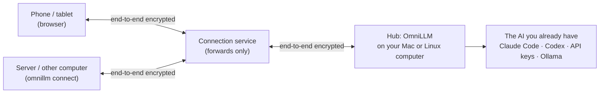

<p align="center"></p>

<h1 align="center">OmniLLM</h1>

<p align="center"><b>Your AI, Everywhere</b><br>Use the Claude, ChatGPT and local models on your Mac from your phone, tablet and servers.</p>

<p align="center">
  <a href="https://github.com/wensuper/OmniLLM/releases"></a>
  <a href="https://github.com/wensuper/OmniLLM/actions/workflows/ci.yml"></a>
  <a href="go.mod"></a>
  <a href="LICENSE"></a>
</p>

<p align="center">English | <a href="README.zh-CN.md">简体中文</a></p>

---

**OmniLLM is not a model.** It has no model of its own, doesn’t route your requests through anyone else’s, and doesn’t sell access to any. It is a small program that runs on **your own computer** (a Mac or a Linux machine, which OmniLLM calls the *hub*) and carries your chats, end-to-end encrypted, between your other devices and the AI you already have on that computer:

- your **Claude** or **ChatGPT subscription** — through the official Claude Code or Codex command-line program, signed in with your own account;
- your **API keys** (Anthropic, OpenAI, or any OpenAI-compatible service);
- **local models** in [Ollama](https://ollama.com).

The models run where they always do: Claude on Anthropic’s servers, ChatGPT on OpenAI’s, Ollama on your computer. OmniLLM only decides which of your devices may use them, and passes the conversation along.

**An example.** You pay for Claude Pro and use it on your Mac. On the train, you open the OmniLLM page on your phone, pick *Claude Opus*, and ask. The question travels encrypted to your Mac; Claude Code there answers with your subscription; the answer comes back to your phone. Nothing is installed on the phone, and your Claude sign-in never leaves the Mac.

| OmniLLM is | OmniLLM is not |
|---|---|
| A personal gateway to AI you already have, running on your own computer | A model, a fine-tune, or a “small model” in front of a big one |
| A way for your phone, tablet, and servers to use that computer’s subscriptions, keys, and local models | A hosted service, a resold API, or a way to share one account with other people |
| An end-to-end encrypted link: the relay in between only forwards data it can’t read | A proxy that sees your chats or holds your credentials |

**Why not just use each app?** One place for all of them: Claude, ChatGPT, API keys, and local models, in one chat on any device. Devices get no credentials, only a daily limit and the models you allow, so a tablet, a family member’s phone, or a server can use them without your password or keys. Scripts on the hub get an OpenAI-compatible local API instead of keys copied around.

## Features

- **Accounts stay on the hub.** Subscriptions, API keys, and local models never leave the computer they are on. Devices never see a credential.
- **End-to-end encrypted.** Devices reach the hub through a connection service that only forwards encrypted data; it can’t read your chats or pretend to be your hub.
- **Checkable, not just trusted.** If someone else runs the relay and the web page, they can’t read your chats, and `omnillm verify web` (which your hub also runs daily) proves the page your phone loads is exactly what a signed release built. See [Security](docs/en/security.md#if-someone-else-runs-the-connection-service-and-the-web-page).
- **No app to install.** Scan a QR code with your phone’s camera and chat in the browser, with text and pictures.
- **You decide who uses what.** Name each device, give it a daily limit, choose which models it may use, or pause it with one switch.
- **Kind to your subscriptions.** Subscriptions are for people chatting, at one person’s pace; scripts and programs use API keys or local models.
- **Takes care of itself.** Runs in the background, updates itself while nobody is using it, and rolls back an update that doesn’t start.

## How it works



Only the hub talks to model providers. The hub opens no ports to the network: it connects out to the connection service, the same way your devices do. See [Security](docs/en/security.md) for what is and isn’t protected.

## Installation

The hub runs on **macOS** and **Linux** (x86-64 and ARM64). Installing needs no `sudo`, takes about a minute, and asks no questions.

### Option 1 — Ask your AI assistant (recommended)

If you use an AI coding assistant on that computer (Claude Code, Codex, Cursor, …), send it this one sentence:

```text
Read https://raw.githubusercontent.com/wensuper/OmniLLM/main/INSTALL.md and install OmniLLM on this computer.
```

It reads the installer before running it, verifies the download, and installs OmniLLM. If no model is connected yet, the console (or a sign-in window for the Claude Code or Codex you are using) helps you connect one first; then it shows the QR code for adding your phone, and you scan it and compare the 6 digits yourself; the assistant never pairs or confirms for you. It never needs your API keys: those go into the OmniLLM console, never into a chat.

### Option 2 — Run the installer yourself

In a terminal, as your normal user:

```bash
curl -fsSL https://raw.githubusercontent.com/wensuper/OmniLLM/main/install.sh | sh
```

The installer downloads the release for your system, checks its SHA-256 checksum (and its signature, if [cosign](https://github.com/sigstore/cosign) is installed), installs `~/.local/bin/omnillm`, starts the hub as a background service, and opens the console in your browser. In the terminal you installed from, use `~/.local/bin/omnillm` until you open a new window.

## Quick start

1. **Connect a model.** With a Claude or ChatGPT subscription (even if you only have the desktop app), choose the button on the Claude or ChatGPT card in the console, or run `omnillm login claude` / `omnillm login chatgpt`. It installs Claude Code or Codex with the official installer if needed, signs you in in the browser, and connects. Without a subscription, paste an API key in the console, or install [Ollama](https://ollama.com) for free local models.
2. **Add your phone.** In the console, choose *Devices → Add device* (on a Mac, also the OmniLLM menu bar icon → *Add device…*; or run `omnillm open --add`) and scan the QR code with your phone’s camera. When the 6 digits on both screens match, choose *Matches, add* on the computer.
3. **Chat.** That’s it — about five minutes in all.

The [quick start guide](docs/en/quickstart.md) covers every step in detail, including servers and scripts.

## Usage

```bash
omnillm status            # what’s running, and what to do next
omnillm open              # open the console (--add: straight to the QR code for adding a device)
omnillm login claude      # connect a Claude subscription (chatgpt: a ChatGPT subscription)
omnillm update            # update now (updates also install by themselves)
omnillm uninstall         # stop and remove the background service (--purge also deletes data and keys)
```

Run `omnillm help --all` for every command.

**Updates** install by themselves: the hub checks every few hours and updates while nobody is using it. To turn that off, run `omnillm update --auto off`. Hubs on 0.2.0-alpha.22 or earlier can’t update themselves yet: run the install command once more (your settings are kept).

## Documentation

| Guide | What’s in it |
|---|---|
| [Quick start](docs/en/quickstart.md) | Every setup step, which models work, adding Linux servers, letting scripts use the hub |
| [Everyday use and FAQ](docs/en/usage.md) | Devices and daily limits, messages and what to do about them, updating and uninstalling |
| [Security](docs/en/security.md) | What OmniLLM protects and what it doesn’t, compared with other approaches |
| [Self-hosting the connection service](docs/en/self-host.md) | Running your own connection service instead of the public one |
| [INSTALL.md](INSTALL.md) | Install steps written for AI assistants |
| [Changelog](CHANGELOG.md) | What changed in each release |

## Project status

OmniLLM is in early pre-release (0.2.0-alpha). Expect rough edges; the hub updates itself, so fixes reach you quickly.

| Platform | Hub | Device |
|---|---|---|
| macOS (Apple silicon and Intel) | ✅ with a menu bar icon | ✅ browser or `omnillm connect` |
| Linux (x86-64 and ARM64) | ✅ | ✅ browser or `omnillm connect` |
| iPhone, iPad, Android | — | ✅ browser, no app |
| Windows | Not yet | ✅ browser |

## Contributing

Issues and pull requests are welcome. Please read [CONTRIBUTING.md](CONTRIBUTING.md) first, and follow our [Code of Conduct](CODE_OF_CONDUCT.md).

## Security

Please report vulnerabilities privately, as described in [SECURITY.md](SECURITY.md). Don’t open a public issue.

## License

OmniLLM is licensed under the [Apache License 2.0](LICENSE).
