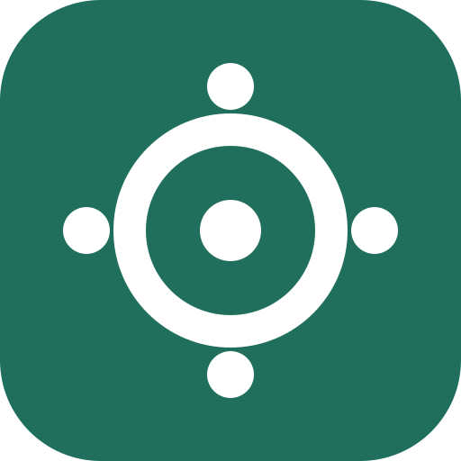
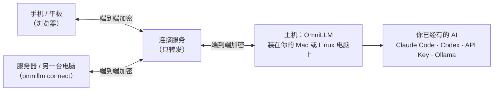

<p align="center"></p>

<h1 align="center">OmniLLM</h1>

<p align="center"><b>Your AI, Everywhere</b><br>在手机、平板、服务器上，用你 Mac 上的 Claude、ChatGPT 和本地模型。</p>

<p align="center">
  <a href="https://github.com/wensuper/OmniLLM/releases"></a>
  <a href="https://github.com/wensuper/OmniLLM/actions/workflows/ci.yml"></a>
  <a href="go.mod"></a>
  <a href="LICENSE"></a>
</p>

<p align="center"><a href="README.md">English</a> | 简体中文</p>

---

**OmniLLM 不是模型。** 它没有自己的模型，不把你的请求转给别人的服务，也不卖任何模型的使用权。它是一个装在**你自己电脑上**的小程序（一台 Mac 或 Linux 电脑，OmniLLM 管它叫“主机”），负责把你其他设备上的对话端到端加密地传到这台电脑，交给你在这台电脑上已经有的 AI：

- 你的 **Claude** 或 **ChatGPT 订阅**：通过官方的 Claude Code 或 Codex 命令行程序，用你自己的账号登录；
- 你的 **API Key**（Anthropic、OpenAI，或任何兼容 OpenAI 接口的服务）；
- [Ollama](https://ollama.com) 里的**本地模型**。

模型还在原来的地方运行：Claude 在 Anthropic 的服务器上，ChatGPT 在 OpenAI 的服务器上，Ollama 在你的电脑上。OmniLLM 只管“哪台设备可以用哪些模型”，并把对话传过去、传回来。

**举个例子。** 你买了 Claude Pro，平时在 Mac 上用。坐地铁时，你在手机上打开 OmniLLM 的网页，选「Claude Opus」提问。问题加密传到你的 Mac，由 Mac 上的 Claude Code 用你的订阅回答，答案再传回手机。手机上什么都不用装，你的 Claude 登录信息也从不离开 Mac。

| OmniLLM 是 | OmniLLM 不是 |
|---|---|
| 装在你自己电脑上的私人通道，连到你已经有的 AI | 一个模型、微调模型，或者套在大模型前面的“小模型” |
| 让手机、平板、服务器用上这台电脑的订阅、Key 和本地模型 | 托管服务、转卖的 API，或者把一个账号分给别人用的工具 |
| 端到端加密：中间的中转服务器只转发它看不懂的数据 | 能看到你对话、或者保管你账号的代理 |

**为什么不直接用各家的 App？** 一处接入全部：Claude、ChatGPT、API Key、本地模型，在任何设备上的同一个对话里用。设备拿不到任何账号，只有你给的每天额度和能用的模型，所以平板、家人的手机、服务器都能用，又不用把密码或 Key 交出去。主机上的脚本走一个兼容 OpenAI 的本机接口，不用到处复制 Key。

## 特性

- **账号只在主机上。** 订阅、API Key、本地模型都留在它们所在的电脑上，设备拿不到任何凭据。
- **端到端加密。** 设备经由连接服务连到主机，连接服务只转发加密数据，看不到对话，也冒充不了你的主机。
- **不用装 App。** 用手机相机扫二维码，在浏览器里对话，文字、图片都行。
- **谁能用什么，你说了算。** 给每台设备起名字、设每天额度、选能用哪些模型，一个开关就能暂停。
- **爱惜你的订阅。** 订阅只给人手动对话用，按一个人聊天的节奏；脚本和程序用 API Key 或本地模型。
- **不用操心。** 在后台运行，没人用的时候自己更新；新版本启动不起来会自动换回原来的版本。

## 工作原理



只有主机和模型提供商通信。主机不对网络开放任何端口：它和设备一样，主动连到连接服务。保护什么、不保护什么，见[安全说明](docs/zh-CN/security.md)。

## 安装

主机支持 **macOS** 和 **Linux**（x86-64、ARM64）。安装不需要 `sudo`，大约一分钟，中途不问任何问题。

### 方法一：交给你的 AI 助手（推荐）

如果这台电脑上有 AI 编程助手（Claude Code、Codex、Cursor 等），把这一句发给它：

```text
请阅读并按照 https://raw.githubusercontent.com/wensuper/OmniLLM/main/INSTALL.md 在这台电脑上安装 OmniLLM。
```

它会先读一遍安装脚本，再下载、核对、安装；装完浏览器里直接是添加手机的二维码，扫码和核对 6 位数由你自己完成，AI 不会替你配对或确认。它用不到你的 API Key：Key 只在 OmniLLM 的控制台里输入，不要贴进任何聊天。

### 方法二：自己运行安装命令

在终端里，用平常的用户（不要 sudo）运行：

```bash
curl -fsSL https://raw.githubusercontent.com/wensuper/OmniLLM/main/install.sh | sh
```

安装脚本会下载对应系统的发布包，核对 SHA-256 校验和（装了 [cosign](https://github.com/sigstore/cosign) 还会核对签名），把程序装到 `~/.local/bin/omnillm`，以后台服务启动主机，并在浏览器里打开控制台。刚装完的那个终端窗口还不认识 `omnillm`：新开一个窗口，或者用完整路径 `~/.local/bin/omnillm`。

## 快速开始

1. **接上模型。** 有 Claude 或 ChatGPT 订阅（只装了桌面版也行）：在控制台里点 Claude 或 ChatGPT 卡片上的按钮，或者运行 `omnillm login claude` / `omnillm login chatgpt`。需要的话它会用官方安装程序装好 Claude Code 或 Codex，在浏览器里登录，然后自动接上。没有订阅：在控制台里粘贴一个 API Key，或者装 [Ollama](https://ollama.com) 用免费的本地模型。
2. **加手机。** 在控制台里点「设备 → 添加设备」（Mac 上也可以点菜单栏的 OmniLLM 图标 →「添加设备…」，或运行 `omnillm open --add`），用手机相机扫二维码。两边显示的 6 位数一致，就在电脑上点「一致，添加」。
3. **开始对话。** 就这些，一共大约 5 分钟。

每一步的细节，以及怎么加服务器、怎么让脚本也能用，见[快速上手](docs/zh-CN/quickstart.md)。

## 常用命令

```bash
omnillm status            # 现在怎么样、下一步做什么
omnillm open              # 打开控制台（--add：直接到添加设备的二维码）
omnillm login claude      # 接上 Claude 订阅（chatgpt：ChatGPT 订阅）
omnillm update            # 马上更新（平时会自己更新）
omnillm uninstall         # 停止并移除后台服务（加 --purge 连数据和 Key 一起删）
```

全部命令见 `omnillm help --all`。

**更新**不用管：主机每隔几小时看一次新版本，在没人用的时候自己更新。不想自动更新，运行 `omnillm update --auto off`。0.2.0-alpha.22 及更早的版本还不会自己更新：再运行一次安装命令（设置都保留），之后就不用管了。

## 文档

| 文档 | 内容 |
|---|---|
| [快速上手](docs/zh-CN/quickstart.md) | 每一步的细节、能用哪些模型、加 Linux 服务器、让脚本也能用 |
| [日常使用和常见问题](docs/zh-CN/usage.md) | 设备和额度、各种提示和处理办法、更新和卸载 |
| [安全说明](docs/zh-CN/security.md) | 保护什么、不保护什么，和别的做法比 |
| [自己部署连接服务](docs/zh-CN/self-host.md) | 不想用公共连接服务时 |
| [INSTALL.md](INSTALL.md) | 写给 AI 助手的安装步骤（英文） |
| [更新记录](docs/zh-CN/CHANGELOG.md) | 每个版本改了什么 |

## 项目状态

OmniLLM 还在早期预发布阶段（0.2.0-alpha），难免有不完善的地方；主机会自己更新，修复能很快到你手上。

| 平台 | 做主机 | 做设备 |
|---|---|---|
| macOS（Apple 芯片、Intel） | ✅ 带菜单栏图标 | ✅ 浏览器或 `omnillm connect` |
| Linux（x86-64、ARM64） | ✅ | ✅ 浏览器或 `omnillm connect` |
| iPhone、iPad、安卓 | — | ✅ 浏览器，不用装 App |
| Windows | 暂不支持 | ✅ 浏览器 |

## 参与贡献

欢迎提 Issue 和 PR。动手之前请先读[贡献指南](docs/zh-CN/CONTRIBUTING.md)，并遵守[行为准则](CODE_OF_CONDUCT.md)。

## 安全问题

请按 [安全问题报告](docs/zh-CN/security-policy.md) 私下报告，不要开公开 Issue。

## 许可证

OmniLLM 按 [Apache License 2.0](LICENSE) 授权。
